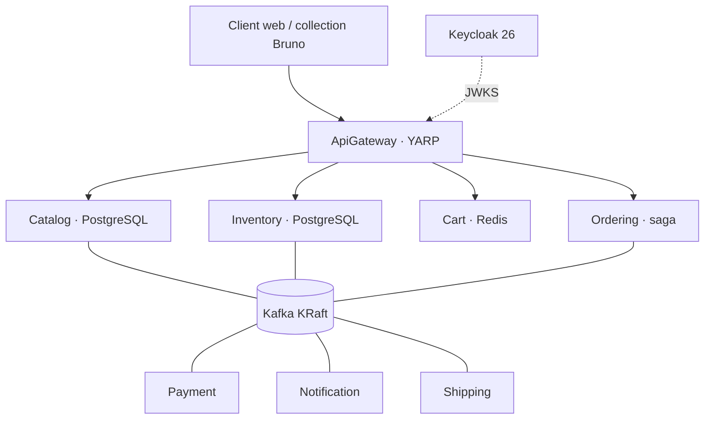

# Souqly — marketplace marocaine en microservices (.NET 10)

Souqly permet à des artisans et petites entreprises marocaines de vendre en ligne : le client cherche, met au panier, commande, paie et est notifié ; le vendeur gère produits et stock. Projet de synthèse du module **SUP351 — Développement avancé des applications** (SupMTI Oujda, 2026-2027).

> Le projet est réalisé en **.NET 10 (ASP.NET Core + Entity Framework Core)** au lieu de Java/Spring Boot, avec l'accord de l'enseignant (voir [ADR-000](docs/adr/ADR-000-plateforme-dotnet.md)).

## Architecture



| Service | Rôle | Stockage | État |
| --- | --- | --- | --- |
| `Catalog` | Produits, catégories, prix | PostgreSQL (`catalog_db`) | Sprint 1 |
| `Inventory` | Stock, réservations sans survente | PostgreSQL (`inventory_db`) | Sprint 1 |
| `Cart` | Panier par client (30 jours) | Redis | Sprint 1 |
| `ApiGateway` | Point d'entrée unique, routage | — | Sprint 1 |
| `Souqly.AppHost` | Lance tout l'environnement en local (Aspire, F5) | — | Sprint 1 |
| `Ordering`, `Payment`, `Notification` | Saga de commande | PostgreSQL, Kafka | Sprints 2-3 |
| `Shipping`, `Search` | Niveau Pro | PostgreSQL, OpenSearch | Sprint 4 |

## Prérequis

- [.NET SDK 10](https://dotnet.microsoft.com/download) (version figée dans `global.json`)
- Docker Desktop (Compose v2)
- 16 Go de RAM recommandés

## Démarrer depuis Visual Studio (F5)

1. Lancer **Docker Desktop**.
2. Ouvrir `Souqly.slnx` dans Visual Studio 2026 (ou 2022 17.14+).
3. Vérifier que **Souqly.AppHost** est le projet de démarrage (clic droit › *Définir comme projet de démarrage*).
4. Appuyer sur **F5**.

Aspire démarre PostgreSQL 16 et Redis 7 en conteneurs, crée les bases, lance Catalog, Inventory, Cart puis la passerelle quand ils sont sains, et ouvre le **tableau de bord** (état, logs, traces). Le lien « Documentation de l'API (Scalar) » de la ligne *gateway* ouvre `http://localhost:8080/scalar`. Les points d'arrêt fonctionnent dans tous les services ([ADR-012](docs/adr/ADR-012-aspire-dev-local.md)).

En ligne de commande : `dotnet run --project src/Aspire/Souqly.AppHost`.

## Démarrer avec Docker Compose (démo, CI)

```bash
cp infra/compose/.env.example infra/compose/.env
docker compose -f infra/compose/compose.yaml up -d --build --wait
open http://localhost:8080/scalar     # documentation de l'API via la passerelle
```

## Développer

```bash
dotnet build Souqly.slnx            # compile toute la solution (avertissements = erreurs)
dotnet test Souqly.slnx             # tests unitaires, API et intégration
dotnet format Souqly.slnx --verify-no-changes
```

Les tests d'intégration utilisent PostgreSQL via Testcontainers (Docker requis). Sans Docker, définir `SOUQLY_TEST_POSTGRES` avec une chaîne de connexion vers un PostgreSQL local.

## Structure

```
src/BuildingBlocks/Souqly.Chassis   # technique transverse : erreurs, pagination, santé
src/Services/<Service>/             # Domain · Application · Infrastructure · Api
tests/<Service>.*Tests              # unitaires, API, intégration, architecture
contracts/openapi · asyncapi        # contrats écrits avant le code
infra/compose · keycloak · postgres # environnement local
docs/adr · architecture · operations · security · compte-rendu
```

## Documentation

- [Décisions d'architecture (ADR)](docs/adr/)
- [Compte rendu d'avancement (PDF)](docs/compte-rendu/)
- [Contribuer](CONTRIBUTING.md)

## Usage de l'IA

L'IA (Claude) a été utilisée pour rédiger le cahier des charges .NET et générer une première version du code et des tests ; chaque usage est consigné dans [docs/ia-journal.md](docs/ia-journal.md), et tout le code fusionné a été relu, compilé et testé.
