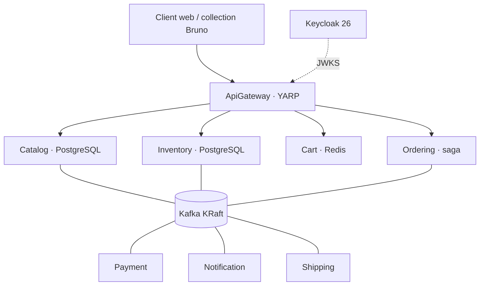

# Souqly — marketplace marocaine en microservices (.NET 10)

Souqly permet à des artisans et petites entreprises marocaines de vendre en ligne : le client cherche, met au panier, commande, paie et est notifié ; le vendeur gère produits et stock. Projet de synthèse du module **SUP351 — Développement avancé des applications** (SupMTI Oujda, 2026-2027).

> Le projet est réalisé en **.NET 10 (ASP.NET Core + Entity Framework Core)** au lieu de Java/Spring Boot, avec l'accord de l'enseignant (voir [ADR-000](docs/adr/ADR-000-plateforme-dotnet.md)).

## Architecture



| Service | Rôle | Stockage | État |
| --- | --- | --- | --- |
| `Catalog` | Produits, catégories, prix | PostgreSQL (`catalog_db`) | Sprint 1 |
| `Inventory` | Stock, réservations sans survente | PostgreSQL (`inventory_db`) | Sprint 1 |
| `Cart` | Panier par client (30 jours) | Redis | Sprint 1 |
| `ApiGateway` | Point d'entrée unique, routage, JWT, limite de débit | — | Sprints 1-2 |
| `Souqly.AppHost` | Lance tout l'environnement en local (Aspire, F5) | — | Sprint 1 |
| `Ordering` | Commandes idempotentes, prix lus dans Catalog (résilient) | PostgreSQL (`ordering_db`) | Sprint 2 |
| Keycloak | Connexion OIDC, rôles, comptes de service ([ADR-003](docs/adr/ADR-003-identite-keycloak.md)) | — | Sprint 2 |
| `Payment` | Paiement simulé (plafond 10 000 MAD), remboursement | PostgreSQL (`payment_db`) | Sprint 3 |
| `Notification` | Messages au client et aux vendeurs | PostgreSQL (`notification_db`) | Sprint 3 |
| Kafka (KRaft) | Saga de commande : outbox, inbox, DLQ ([ADR-004](docs/adr/ADR-004-kafka-outbox-inbox.md), [ADR-005](docs/adr/ADR-005-saga-orchestree.md)) | — | Sprint 3 |
| `Shipping`, `Search` | Niveau Pro | PostgreSQL, OpenSearch | Sprint 4 |

## Prérequis

- [.NET SDK 10](https://dotnet.microsoft.com/download) (version figée dans `global.json`)
- Docker Desktop (Compose v2)
- 16 Go de RAM recommandés

## Démarrer depuis Visual Studio (F5)

1. Lancer **Docker Desktop**.
2. Ouvrir `Souqly.slnx` dans Visual Studio 2026 (ou 2022 17.14+).
3. Vérifier que **Souqly.AppHost** est le projet de démarrage (clic droit › *Définir comme projet de démarrage*).
4. Appuyer sur **F5**.

Aspire démarre PostgreSQL 16, Redis 7, Keycloak 26 et Kafka en conteneurs, crée les bases, importe le realm `souqly`, lance les six services puis la passerelle quand ils sont sains, et ouvre le **tableau de bord** (état, logs, traces). Le lien « Documentation de l'API (Scalar) » de la ligne *gateway* ouvre `http://localhost:8080/scalar`. Les points d'arrêt fonctionnent dans tous les services ([ADR-012](docs/adr/ADR-012-aspire-dev-local.md)).

Le **site web** (ligne *web* du tableau de bord) s'ouvre sur **http://localhost:5173** : catalogue, panier, commande et suivi pour un client, produits, stock et expéditions pour un vendeur. 

En ligne de commande : `dotnet run --project src/Aspire/Souqly.AppHost`.

## Le site web

Projet ASP.NET Core `src/Web/Souqly.Web` : les pages sont du **HTML, CSS et JavaScript** (sans framework, dans `wwwroot`), servies par ASP.NET Core. Lancé par F5 avec le reste, il s'ouvre sur **http://localhost:5173**.

| Écran | Acteur | Stories |
|---|---|---|
| Catalogue (catégories, recherche, tri, pagination), fiche produit | visiteur | US-01, US-02 |
| Panier, validation et paiement de test | client | US-05, US-06, US-09 |
| Mes commandes, suivi (rafraîchi toutes les secondes), annulation, colis | client | US-07, US-08, US-14 |
| Mes produits, mon stock, commandes à préparer et expédition | vendeur | US-03, US-10, US-13 |
| Notifications | client, vendeur | US-15 |
| Vendre sur Souqly : demande de boutique, suivi, activation de l'espace vendeur | visiteur, client | US-16 |
| Tableau de bord : ventes du jour, commandes à préparer, ruptures et stocks bas | vendeur | US-17 |
| Demandes de boutique (valider, refuser avec motif), journal d'audit | administrateur | US-16, US-18 |

- **Connexion Keycloak côté serveur** (Authorization Code + PKCE, client `souqly-web`) : les jetons restent dans le cookie de session chiffré (`HttpOnly`), **le JavaScript ne voit jamais de jeton** (modèle *Backend for Frontend*).
- Le JavaScript appelle `/api/...` sur le même site ; ASP.NET Core ajoute le jeton (renouvelé automatiquement) et relaie vers la passerelle (YARP).
- Protection CSRF : cookie `SameSite=Lax` et en-tête `X-Souqly` exigé sur tout appel modifiant.
- Masquer un bouton ne protège rien : chaque service vérifie les rôles.

## Démarrer avec Docker Compose (démo, CI)

```bash
cp infra/compose/.env.example infra/compose/.env
docker compose -f infra/compose/compose.yaml up -d --build --wait
open http://localhost:8080/scalar     # documentation de l'API via la passerelle
```

## Suivre une commande à travers Kafka

1. Passer une commande (Scalar › ordering › `POST /api/v1/orders`) : réponse **202**, statut `PENDING`.
2. Relire la commande quelques instants plus tard : `CONFIRMED` (ou `REJECTED` avec la raison).
3. **Kafka UI** (lien `kafka-ui` dans le tableau de bord Aspire, ou http://localhost:8085) : topics `souqly.*.v1`, un message par étape, clé = numéro de commande.
4. **Traces** (onglet Traces d'Aspire) : une seule trace va de la requête HTTP jusqu'à la confirmation, à travers les quatre services.
5. Pour voir la compensation : commander pour plus de 10 000 MAD → paiement refusé, stock rendu ; ou annuler une commande confirmée → remise en stock et remboursement.

Contrat des événements : [`contracts/asyncapi/souqly.yaml`](contracts/asyncapi/souqly.yaml).

## Observer la plateforme (Grafana)

F5 démarre aussi **Grafana** (lien « Grafana (tableaux de bord) » dans Aspire, http://localhost:3000, accès sans connexion en développement). Le tableau de bord **Souqly — Vue d'ensemble** s'ouvre par défaut : commandes par minute, taux d'échec, durée de la saga, messages en DLQ, latence et erreurs par service. Les alertes (Alerting › Alert rules, dossier Souqly) et le tableau de bord sont versionnés dans [`infra/grafana`](infra/grafana) ([ADR-014](docs/adr/ADR-014-observabilite-grafana.md)). Que faire quand une alerte sonne : [runbook](docs/operations/runbook.md).

Pour voir la reprise après panne : arrêter `payment` dans Aspire (bouton ■), passer une commande (elle reste en `STOCK_RESERVED`), redémarrer `payment` (▶) : la commande passe à `CONFIRMED`.

## Comptes de démonstration

Realm Keycloak `souqly` (console : http://localhost:8180, utilisateur `admin`). Mot de passe des comptes : `Souqly-Dev-2026!` (développement uniquement).

| Compte | Rôles | Pour tester |
| --- | --- | --- |
| `sara` | CUSTOMER | panier, commandes |
| `fatima`, `karim` | VENDOR (+ CUSTOMER) | produits, stock, commandes reçues |
| `admin-souqly` | ADMIN (+ CUSTOMER) | demandes de boutique, journal d'audit |

Pour tester US-16 : créez un compte (lien « Créer un compte » de la page de connexion), demandez une boutique dans **Vendre sur Souqly**, validez-la avec `admin-souqly` (**Boutiques**), puis revenez sur le premier compte et cliquez **Activer mon espace vendeur** : le rôle VENDOR est attribué dans Keycloak par le compte technique `catalog-service` (créé automatiquement au démarrage par l'AppHost).

Dans Scalar, **Authorize › oauth2 › Authorize** ouvre la page de connexion Keycloak (PKCE). En ligne de commande :

```bash
TOKEN=$(curl -s -X POST http://localhost:8180/realms/souqly/protocol/openid-connect/token \
  -d grant_type=password -d client_id=souqly-dev -d username=sara -d 'password=Souqly-Dev-2026!' | jq -r .access_token)
curl -H "Authorization: Bearer $TOKEN" http://localhost:8080/api/v1/orders
```

## Développer

```bash
dotnet build Souqly.slnx            # compile toute la solution (avertissements = erreurs)
dotnet test Souqly.slnx             # tests unitaires, API et intégration
dotnet format Souqly.slnx --verify-no-changes
```

Les tests d'intégration utilisent PostgreSQL via Testcontainers (Docker requis). Sans Docker, définir `SOUQLY_TEST_POSTGRES` avec une chaîne de connexion vers un PostgreSQL local.

### Tests d'acceptation (Gherkin)

Les critères d'acceptation des stories sont écrits en **Gherkin, en français**, dans `tests/Acceptance.Tests/Features/*.feature`, et **exécutés** par Reqnroll contre les services réels démarrés en mémoire (passerelle, Catalog, Cart, Ordering, Inventory, Payment, Notification ; seul Keycloak est remplacé par des jetons de test). Ils tournent dans la CI avec le reste : `dotnet test tests/Acceptance.Tests`.

## Structure

```
src/BuildingBlocks/Souqly.Chassis   # technique transverse : erreurs, pagination, santé
src/Services/<Service>/             # Domain · Application · Infrastructure · Api
tests/<Service>.*Tests              # unitaires, API, intégration, architecture
tests/Acceptance.Tests/Features     # critères d'acceptation Gherkin exécutables (Reqnroll)
src/Web/Souqly.Web                  # site web : HTML, CSS, JavaScript servis par ASP.NET Core
contracts/openapi · asyncapi        # contrats écrits avant le code
infra/compose · keycloak · postgres # environnement local
docs/adr · architecture · operations · security · compte-rendu
```

## Documentation

- [Décisions d'architecture (ADR)](docs/adr/)
- [Modèle de menaces (STRIDE)](docs/security/threat-model.md) et [registre des traitements (loi 09-08)](docs/security/registre-traitements.md)
- [Compte rendu d'avancement (PDF)](docs/compte-rendu/)
- [Contribuer](CONTRIBUTING.md)

## Usage de l'IA

L'IA (Claude) a été utilisée pour rédiger le cahier des charges .NET et générer une première version du code et des tests ; chaque usage est consigné dans [docs/ia-journal.md](docs/ia-journal.md), et tout le code fusionné a été relu, compilé et testé.
