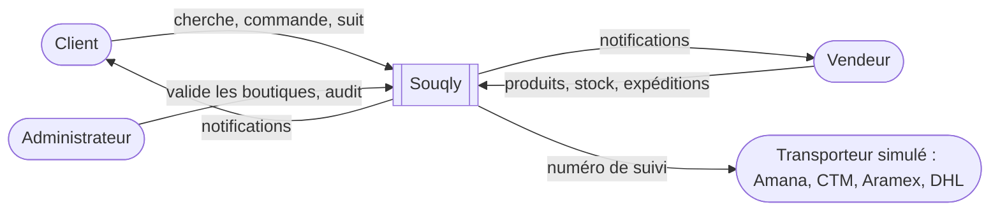
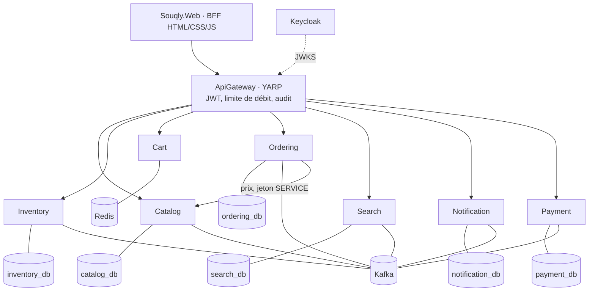
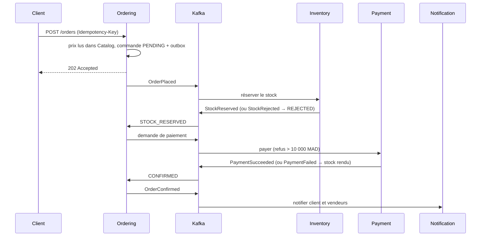
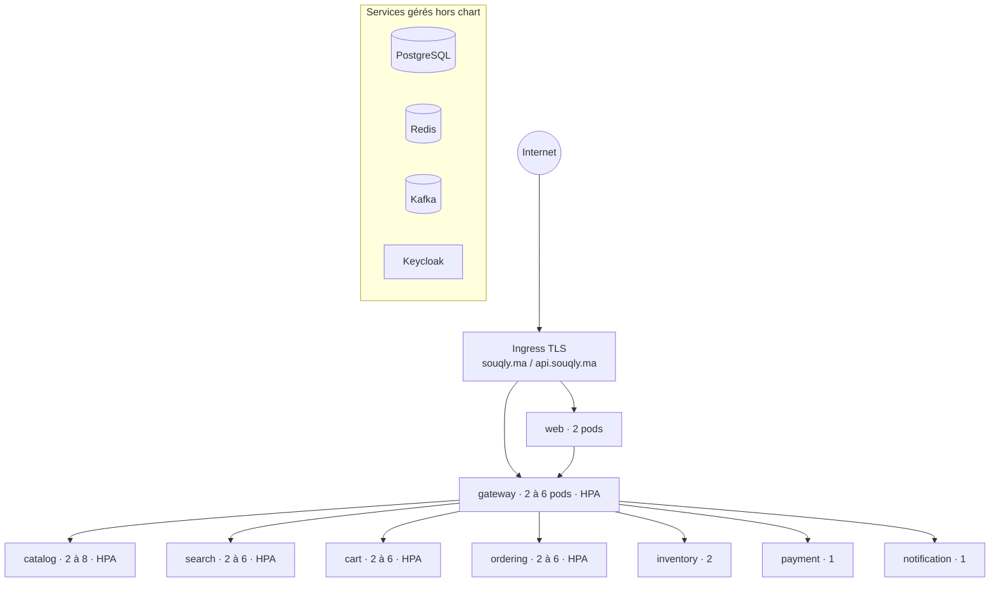

# Souqly — Documentation d'architecture (arc42)

Version 1.0 · 23/11/2026 · module SUP351, SupMTI Oujda.
Ce document suit le modèle [arc42](https://arc42.org) (12 sections). Il résume et relie les décisions détaillées dans les [ADR](../adr/), le [modèle de menaces](../security/threat-model.md) et le [runbook](../operations/runbook.md).

---

## 1. Introduction et objectifs

Souqly est une marketplace marocaine : des artisans et petites entreprises vendent en ligne ; le client cherche, met au panier, commande, paie (paiement simulé) et suit sa livraison ; le vendeur gère produits, stock et expéditions ; l'administrateur valide les boutiques et contrôle le journal d'audit.

### 1.1 Exigences principales

| Domaine | User stories |
| --- | --- |
| Catalogue et recherche | US-01 parcourir, US-02 fiche produit, US-03 gérer ses produits, US-04 rechercher |
| Panier et commande | US-05 panier, US-06 commander, US-07 suivre, US-08 annuler, US-09 payer |
| Stock | US-10 gérer son stock, US-11 réserver sans survente, US-12 alerte de stock bas |
| Livraison et notifications | US-13 expédier, US-14 suivre la livraison, US-15 notifications |
| Administration | US-16 devenir vendeur, US-17 tableau de bord vendeur, US-18 journal d'audit |
| Exploitation | US-19 une trace par commande, US-20 alerte si plus de 2 % d'échecs |

### 1.2 Objectifs de qualité

| Priorité | Objectif | Mesure |
| --- | --- | --- |
| 1 | **Fiabilité** : aucune commande perdue, aucune survente | Saga avec outbox/inbox ; test « 500 acheteurs, 100 unités, 0 survente » ; panne de Payment sans perte |
| 2 | **Sécurité** : chaque service vérifie l'identité et les droits | JWT validé dans la passerelle et chaque service ; STRIDE |
| 3 | **Performance** : catalogue rapide en pic | SLO k6 : catalogue p95 < 300 ms, recherche p95 < 500 ms, commande p95 < 800 ms, erreurs < 1 % |
| 4 | **Observabilité** : diagnostiquer vite | Une trace de bout en bout par commande ; tableau de bord et alertes versionnés |
| 5 | **Simplicité de développement** | Toute la plateforme démarre par F5 (Aspire) |

### 1.3 Parties prenantes

| Rôle | Attente |
| --- | --- |
| Client | Trouver, commander et suivre facilement |
| Vendeur (artisan) | Gérer ses produits et ses colis sans compétence technique |
| Administrateur | Valider les boutiques, tracer les actions sensibles |
| Enseignant (SUP351) | Architecture microservices justifiée, testée, documentée |
| Développeur | Démarrer, tester et déployer sans friction |

---

## 2. Contraintes

| Contrainte | Origine | Conséquence |
| --- | --- | --- |
| .NET 10 + EF Core au lieu de Java/Spring | Accord de l'enseignant ([ADR-000](../adr/ADR-000-plateforme-dotnet.md)) | Équivalences : Spring Cloud Gateway → YARP, Resilience4j → Polly, Testcontainers → PostgreSQL réel en test |
| Microservices, une base par service | Énoncé du module ([ADR-001](../adr/ADR-001-microservices.md)) | Aucun service ne lit la base d'un autre ; échanges par HTTP ou Kafka |
| Poste de développement de 16 Go | Matériel de l'étudiant | Search sur PostgreSQL plutôt qu'OpenSearch ([ADR-015](../adr/ADR-015-recherche-postgresql-trigrammes.md)) ; Grafana en une seule image |
| Paiement simulé | Pas de prestataire réel | Refus automatique au-delà de 10 000 MAD pour tester la compensation |
| Site en HTML/CSS/JS servi par ASP.NET Core | Choix de l'étudiant | Pas de framework front ; modèle *Backend for Frontend* pour les jetons |
| Code et documentation en français | Module | Noms de tests en français (`US06_…`), messages d'erreur en français |

---

## 3. Contexte

### 3.1 Contexte métier



### 3.2 Contexte technique

| Interface | Protocole | Usage |
| --- | --- | --- |
| Navigateur → site | HTTP(S), cookie de session `HttpOnly` | Pages et `/api/*` relayé à la passerelle |
| Site / Scalar → passerelle | HTTP(S) + JWT Bearer | API REST (`/api/v1/...`), contrats OpenAPI dans `contracts/openapi` |
| Navigateur → Keycloak | OIDC Authorization Code + PKCE | Connexion, inscription |
| Services → Kafka | Kafka (KRaft) | Événements `souqly.<service>.<flux>.v1`, contrat AsyncAPI dans `contracts/asyncapi` |
| Services → Grafana | OTLP gRPC | Traces, métriques, logs |

---

## 4. Stratégie de solution

| Problème | Solution | Décision |
| --- | --- | --- |
| Lectures 50× plus nombreuses que les commandes | Services séparés, mise à l'échelle indépendante (HPA) | [ADR-001](../adr/ADR-001-microservices.md), [ADR-016](../adr/ADR-016-deploiement-kubernetes-helm.md) |
| Transaction qui traverse Stock, Paiement, Notification | Saga orchestrée par Ordering, compensations | [ADR-005](../adr/ADR-005-saga-orchestree.md) |
| Ne jamais perdre ni doubler un message | Outbox transactionnelle + inbox idempotente + DLQ | [ADR-004](../adr/ADR-004-kafka-outbox-inbox.md) |
| Survente en vente flash | `UPDATE … WHERE disponible >= quantité` + contraintes `CHECK` | [ADR-007](../adr/ADR-007-prevention-survente.md) |
| Identité et rôles | Keycloak, JWT validé partout, comptes de service | [ADR-003](../adr/ADR-003-identite-keycloak.md) |
| Recherche tolérante aux fautes | Modèle de lecture CQRS alimenté par les événements de Catalog | [ADR-015](../adr/ADR-015-recherche-postgresql-trigrammes.md) |
| Démarrage local complexe | Aspire : F5 lance tout | [ADR-012](../adr/ADR-012-aspire-dev-local.md) |
| Diagnostic en production | OpenTelemetry + Grafana, alertes versionnées | [ADR-014](../adr/ADR-014-observabilite-grafana.md) |

---

## 5. Vue en blocs

### 5.1 Niveau 1 : la plateforme



| Bloc | Responsabilité | Stockage |
| --- | --- | --- |
| `Souqly.Web` | Pages, connexion OIDC côté serveur, relais `/api` avec le jeton | Cookie chiffré |
| `ApiGateway` | Point d'entrée unique, routage, validation JWT, 429, journal d'audit et parcours (US-18) | Redis |
| `Catalog` | Produits, catégories, boutiques (US-16), événements produit | `catalog_db` |
| `Inventory` | Stock, réservations, seuil d'alerte (US-12) | `inventory_db` |
| `Cart` | Panier par client, 30 jours | Redis |
| `Ordering` | Commandes, saga, expéditions, tableau de bord vendeur | `ordering_db` |
| `Payment` | Paiement simulé, remboursement | `payment_db` |
| `Notification` | Messages client et vendeur | `notification_db` |
| `Search` | Index de recherche (CQRS) | `search_db` |

### 5.2 Niveau 2 : l'intérieur d'un service

Chaque service riche suit la même découpe (Clean Architecture), vérifiée par `Catalog.ArchitectureTests` :

```
Souqly.<Service>.Domain          règles métier, aucune dépendance
Souqly.<Service>.Application     cas d'usage, ports (interfaces)
Souqly.<Service>.Infrastructure  EF Core, HTTP, Kafka
Souqly.<Service>.Api             endpoints minimal API, validation, composition
```

Les services simples (Payment, Notification, Search) tiennent en un projet ([ADR-013](../adr/ADR-013-services-simples.md)). Le code commun vit dans `Souqly.Chassis` (erreurs RFC 9457, santé, télémétrie) et `Souqly.Messaging` (outbox, inbox, DLQ).

---

## 6. Vue d'exécution

### 6.1 Passer une commande (saga)



Chaque flèche Kafka passe par l'outbox de l'émetteur et l'inbox du récepteur : un message n'est ni perdu (broker arrêté) ni appliqué deux fois (livraison en double). Après 3 échecs, il part en DLQ et une alerte sonne.

### 6.2 Expédier et livrer

Le vendeur déclare son colis (`POST /vendor/orders/{id}/shipment`, transporteur + numéro de suivi). La commande passe à `SHIPPED` quand tous les vendeurs ont expédié, puis `DELIVERED`. `OrderShipped` et `OrderDelivered` déclenchent les notifications ; la page du client anime la camionnette.

### 6.3 Indexer un produit pour la recherche

Catalog écrit le produit et l'événement `ProductCreated/Updated/Archived` dans la même transaction (outbox). Search consomme l'événement et met à jour `search_db` ; il ignore une version plus ancienne. Au démarrage, Search se réconcilie avec Catalog.

### 6.4 Devenir vendeur

Le client dépose une demande de boutique ; l'administrateur la valide ; Catalog attribue le rôle VENDOR dans Keycloak avec le compte technique `catalog-service` ; le site rafraîchit le jeton pour que le rôle s'applique sans reconnexion.

---

## 7. Vue de déploiement

### 7.1 Développement : Aspire (F5)

Visual Studio lance `Souqly.AppHost` : PostgreSQL, Redis, Keycloak, Kafka et Grafana en conteneurs, les services en processus .NET (points d'arrêt possibles), tableau de bord Aspire pour les logs et les traces.

### 7.2 Démo et CI : Docker Compose

`infra/compose/compose.yaml` construit les images (Dockerfile multi-étapes, utilisateur non root) ; seuls la passerelle (8080), le site (5173), Keycloak (8180) et Grafana (3000) sont publiés.

### 7.3 Production : Kubernetes avec Helm



Chart `deploy/helm/souqly` ([ADR-016](../adr/ADR-016-deploiement-kubernetes-helm.md)) :

- un `Deployment` + `Service` par microservice, sondes `/health/live` et `/health/ready`, requêtes et limites CPU/mémoire ;
- `HorizontalPodAutoscaler` (cible 70 % CPU) sur les services exposés aux pics : gateway, catalog, search, cart, ordering ;
- `PodDisruptionBudget` pour les services à plusieurs répliques ;
- `NetworkPolicy` : seuls l'ingress joint `web` et `gateway`, seule la passerelle joint les services ;
- conteneurs non root, système de fichiers en lecture seule, `seccomp` par défaut ;
- secrets dans un `Secret` Kubernetes créé hors du chart (ou par le chart en démonstration).

Bases, Kafka et Keycloak sont des services gérés (ou leurs propres charts) : leurs adresses sont des valeurs.

---

## 8. Concepts transverses

| Concept | Mise en œuvre |
| --- | --- |
| Sécurité | OIDC + PKCE ; JWT RS256 vérifié par la passerelle **et** chaque service ; identité lue dans `sub` uniquement ; 404 au lieu de 403 pour la ressource d'autrui ; BFF : le JavaScript ne voit jamais de jeton ; CSRF par `SameSite=Lax` + en-tête `X-Souqly` |
| Erreurs | `application/problem+json` (RFC 9457) avec `traceId`, sans pile d'appels |
| Résilience | Polly (délai, nouvel essai, disjoncteur) sur l'appel Ordering → Catalog, 503 + `Retry-After` |
| Idempotence | `Idempotency-Key` sur la commande ; inbox par `message-id` sur Kafka |
| Concurrence | Jeton `xmin` (409) ; mise à jour conditionnelle du stock |
| Argent | `decimal`, `NUMERIC(12,2)` ; prix toujours lu côté serveur |
| Observabilité | OpenTelemetry : traces propagées dans les en-têtes Kafka (`traceparent`), métriques métier (`souqly.orders.*`), logs structurés |
| Audit | Passerelle : action, utilisateur, ressource, statut, horodatage, dans une liste Redis bornée |
| Tests | Unitaires, API sur PostgreSQL réel, saga de bout en bout, Kafka réel, critères Gherkin exécutables (Reqnroll), architecture, charge (k6) |
| Versions d'API | `/api/v1`, topics suffixés `.v1`, contrats OpenAPI et AsyncAPI versionnés |

---

## 9. Décisions d'architecture

| ADR | Décision |
| --- | --- |
| [000](../adr/ADR-000-plateforme-dotnet.md) | .NET 10 au lieu de Java 21 / Spring Boot |
| [001](../adr/ADR-001-microservices.md) | Microservices plutôt que monolithe modulaire |
| [002](../adr/ADR-002-monorepo.md) | Monorepo, solution .NET unique |
| [003](../adr/ADR-003-identite-keycloak.md) | Keycloak, JWT validé par chaque service |
| [004](../adr/ADR-004-kafka-outbox-inbox.md) | Kafka avec outbox et inbox |
| [005](../adr/ADR-005-saga-orchestree.md) | Saga orchestrée par Ordering |
| [007](../adr/ADR-007-prevention-survente.md) | Survente évitée par mise à jour conditionnelle |
| [012](../adr/ADR-012-aspire-dev-local.md) | Aspire pour le développement local |
| [013](../adr/ADR-013-services-simples.md) | Un seul projet pour les services simples |
| [014](../adr/ADR-014-observabilite-grafana.md) | OpenTelemetry et Grafana |
| [015](../adr/ADR-015-recherche-postgresql-trigrammes.md) | Search sur PostgreSQL pg_trgm |
| [016](../adr/ADR-016-deploiement-kubernetes-helm.md) | Déploiement Kubernetes avec un chart Helm unique et HPA |

---

## 10. Exigences de qualité

### 10.1 Objectifs de service (SLO), vérifiés par k6

| Indicateur | Objectif | Seuil k6 |
| --- | --- | --- |
| Liste du catalogue | p95 < 300 ms | `http_req_duration{endpoint:catalog}` |
| Recherche | p95 < 500 ms | `http_req_duration{endpoint:search}` |
| Création de commande (202) | p95 < 800 ms | `http_req_duration{endpoint:order}` |
| Erreurs HTTP | < 1 % | `http_req_failed` |
| Saga complète | p95 < 5 s | métrique `souqly.order.saga.duration` dans Grafana |
| Échecs techniques de commande | < 2 % sur 5 min | alerte Grafana (US-20) |

### 10.2 Scénarios de qualité

| Scénario | Réponse attendue | Preuve |
| --- | --- | --- |
| 500 acheteurs simultanés sur 100 unités | 100 ventes, 0 survente | `FlashSaleTests` |
| Payment arrêté pendant une commande | La commande attend en `STOCK_RESERVED` puis se confirme au redémarrage | test de reprise, démo Aspire |
| Catalog en panne | Ordering répond 503 en moins de 3 s | `Catalogue_en_panne_…` |
| Double clic sur « Commander » | Une seule commande | `US09_dix_envois_simultanes_…` |
| Pic de trafic sur le catalogue | Le HPA ajoute des pods ; p95 reste < 300 ms | k6 scénario `pic` |
| Jeton falsifié | 401 | `ApiGateway.Tests` |

---

## 11. Risques et dette technique

| Risque / dette | Impact | Traitement |
| --- | --- | --- |
| Saga p95 mesurée à 7 s (objectif 5 s) : l'outbox est lue toutes les 0,5 s | Confirmation plus lente | Réveiller le publieur à l'écriture ; réduire `fetch.wait.max.ms` |
| Kafka sans authentification | Message forgé possible depuis le réseau interne | `NetworkPolicy` en Kubernetes ; SASL/mTLS et ACL à ajouter |
| Keycloak en `start-dev` en local | Pas représentatif de la production | Keycloak avec PostgreSQL dédié en production |
| Journal d'audit dans Redis (liste bornée) | Historique limité | Exporter vers Loki ou une base dédiée |
| Search sans analyse linguistique | Pas de synonymes ni de racines | Passer à OpenSearch si le catalogue grandit (seule l'implémentation de l'index change) |
| Client `souqly-dev` (mot de passe direct) | Contournement de PKCE | À retirer du realm de production |

---

## 12. Glossaire

| Terme | Définition |
| --- | --- |
| BFF | *Backend for Frontend* : le serveur du site garde les jetons et relaie les appels |
| CQRS | Séparer le modèle d'écriture (Catalog) du modèle de lecture (Search) |
| DLQ | File des messages qui ont échoué 3 fois |
| HPA | *HorizontalPodAutoscaler* : ajoute ou retire des pods selon la charge |
| Inbox | Table des messages déjà traités, pour ignorer les doublons |
| Outbox | Table où le message est écrit dans la même transaction que la donnée, puis publié |
| PKCE | Protection du flux de connexion OIDC pour les clients publics |
| Saga | Suite d'étapes locales avec compensations, à la place d'une transaction distribuée |
| SLO | Objectif chiffré de qualité de service |
| MAD | Dirham marocain |
